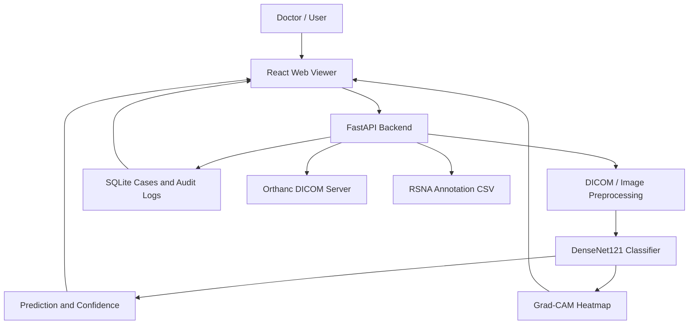

# Architecture and API Documentation

## 1. System Overview

AI-Assisted Medical Imaging and Diagnosis System is a research prototype for chest X-ray analysis.

### Architecture

## 2. Main Components

- **Frontend:** React application built with Vite.
- **Backend:** FastAPI REST API.
- **Classification:** DenseNet121 transfer-learning model.
- **Preprocessing:** MONAI transforms, resizing and intensity normalization.
- **Explainability:** Grad-CAM heatmap and overlay.
- **Storage:** SQLite case records and audit logs.
- **DICOM integration:** Orthanc server.
- **Deployment:** Docker Compose.

## 3. API Endpoints

| Method | Endpoint | Purpose |
|---|---|---|
| GET | `/health` | Backend health and model status |
| POST | `/predict` | Upload an image and obtain prediction |
| GET | `/cases` | List stored cases |
| GET | `/cases/{case_id}` | Retrieve case details |
| GET | `/cases/{case_id}/image` | Retrieve original scan |
| GET | `/cases/{case_id}/heatmap` | Retrieve Grad-CAM heatmap |
| GET | `/cases/{case_id}/localization` | Retrieve RSNA annotation overlay when available |
| POST | `/cases/{case_id}/review` | Save doctor review |
| GET | `/cases/{case_id}/audit` | Retrieve case audit history |

## 4. Data Flow

1. User uploads a supported image.
2. Backend preprocesses the scan.
3. DenseNet121 generates a classification prediction.
4. Grad-CAM generates a visual explanation.
5. Case details and review information are stored.
6. Frontend displays the scan, prediction, confidence, heatmap and review controls.

## 5. DICOM and Localization

The application supports DICOM input. RSNA bounding-box annotations can be displayed when the corresponding annotation CSV and scan are available.

The localization overlay represents dataset ground-truth annotations. It is not an independently trained AI segmentation output.

## 6. Security and Limitations

- Orthanc access is configured with authentication.
- Local storage and API access must be protected before any real deployment.
- The current prototype is not validated for clinical use.
- Authentication and authorization for clinical users require further hardening.
- Automatic continuous Orthanc study polling has not been established as a completed feature.
